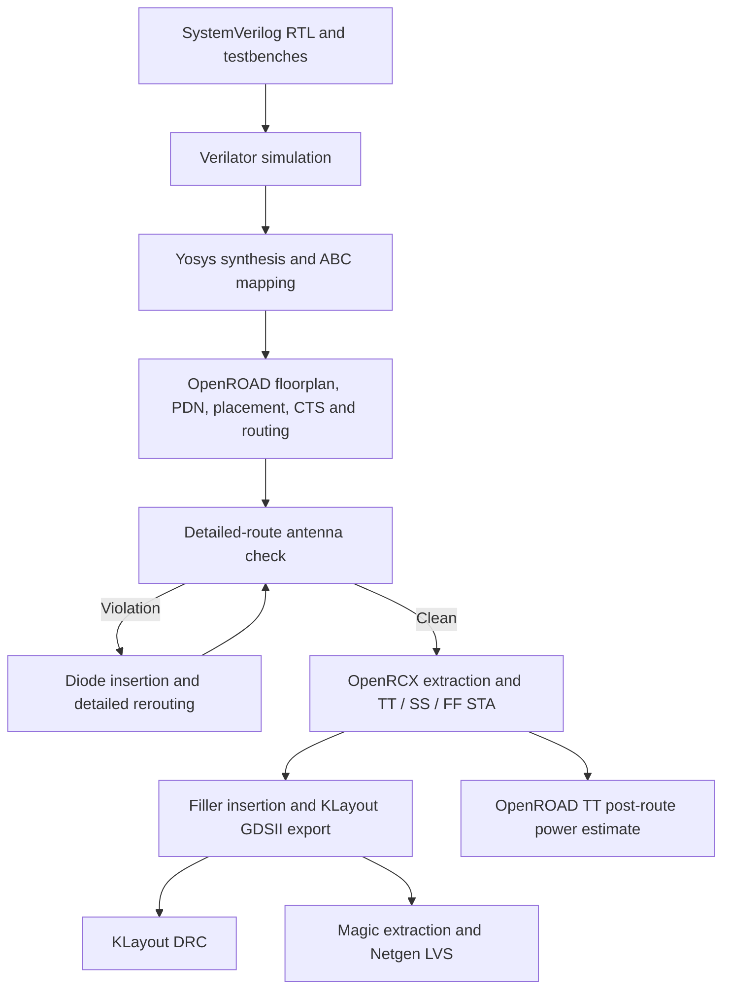
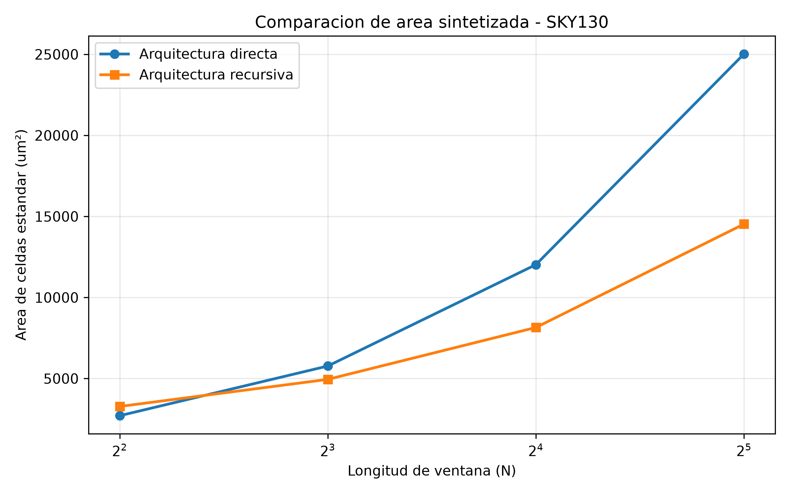
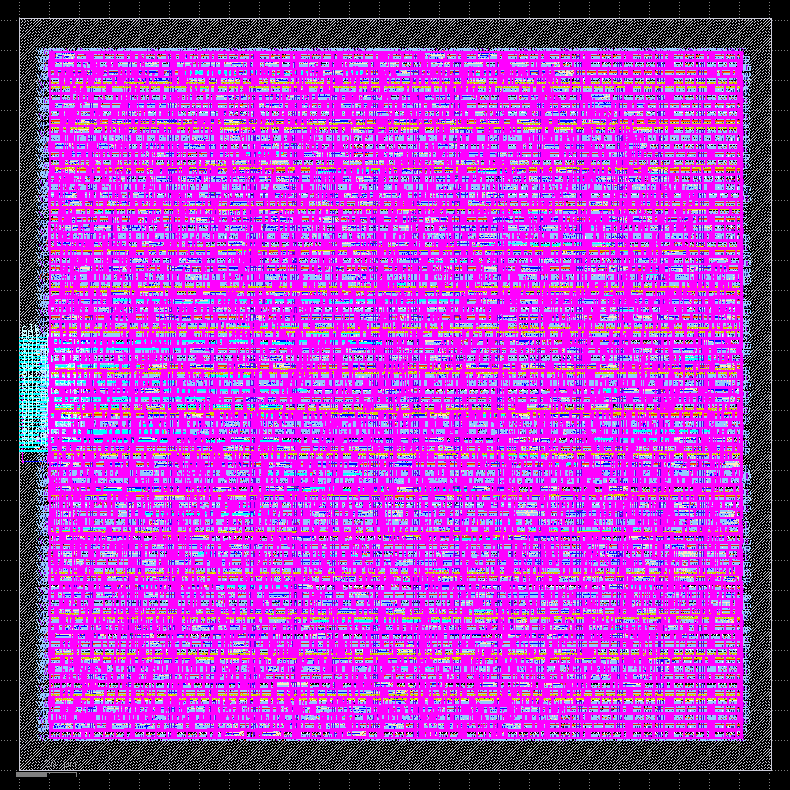
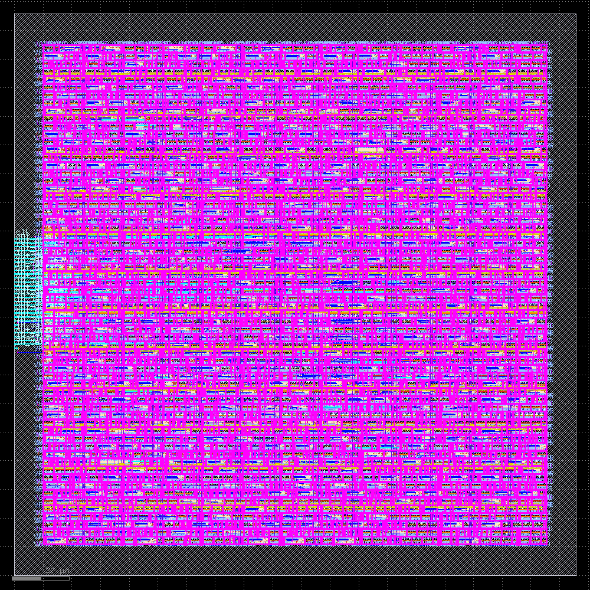

# Moving-average filters in SKY130

This project compares direct and recursive implementations of an unsigned moving-average filter from SystemVerilog through routed SKY130 HD layouts. The study evaluates how the window length affects cell area, routed wirelength, static timing and estimated power. The eight configurations use `DATA_W=12` and `WINDOW_N=4, 8, 16, 32`.

## Architectures

For the accepted input sample $x[k]$ and window length $N$, the output is the truncated integer mean once the window is full.

$$
S[k] = \sum_{i=0}^{N-1} x[k-i], \qquad y[k] = \left\lfloor S[k]/N \right\rfloor
$$

The [direct filter](rtl/filters/moving_average_direct.sv) uses a balanced adder tree over the current sample and the preceding $N-1$ samples. The [recursive filter](rtl/filters/moving_average_recursive.sv) stores $N$ previous samples and updates a running sum. It treats the outgoing sample as zero during startup.

$$
S[k] = S[k-1] - x[k-N] + x[k]
$$

Both designs use a sum width of $12 + \log_2 N$ bits and divide by shifting right by $\log_2 N$. The index $k$ advances when both `enable` and `in_valid` are asserted on the rising clock edge. The first output is valid on the $N$th accepted sample after synchronous active-low reset.

## RTL-to-GDSII flow



| Tool | Version |
|---|---|
| Verilator | 5.052 |
| Yosys with ABC | Yosys 0.69, commit `9f75ca1f9` |
| OpenROAD with OpenRCX and OpenSTA | `26Q3-2443-g50432012f` |
| KLayout | 0.30.12 |
| Magic | 8.3 revision 684, recorded in extraction logs |
| Netgen | 1.5.323, recorded in LVS logs |
| Python | 3.12.3 |

The physical flow expects SKY130A at `/foss/pdks/sky130A` and OpenROAD-flow-scripts' `def2stream.py` at `/foss/designs/orfs/flow/util/def2stream.py`. The installed SKY130A resolves to Ciel revision `1689ac3f2dc763876eaf967227c7dfe831b031ae`. This environment provides OpenROAD-flow-scripts at commit `3a964e13f11a4e435aac01ffa14db0a7d2853720`. Install the EDA tools on `PATH` and provide a C++ build toolchain for Verilator and Matplotlib for the power plot. The flow uses the [20 ns timing constraints](constraints/sta_preplacement.sdc).

## Repository layout

| Path | Contents |
|---|---|
| [rtl/filters/](rtl/filters/) and [tb/](tb/) | RTL and simulation testbenches |
| [scripts/](scripts/) and [constraints/](constraints/) | Flow Tcl, analysis scripts and timing constraints |
| [docs/](docs/) | Reproduction, design flow and antenna repair |
| [evidence/data/](evidence/data/) and [evidence/power/](evidence/power/) | Original result CSVs and per-case power reports |
| [evidence/figures/](evidence/figures/) | Comparison plots and KLayout screenshots |
| [evidence/gds/](evidence/gds/) | One verified GDSII per configuration |
| [evidence/verification/](evidence/verification/) | Routing, STA, antenna, DRC and LVS evidence |
| [paper/](paper/) | Draft research article |

## Simulation

Run the equivalence testbench for all window sizes from the repository root. It compares both filters with an independent reference model. [The testbench directory](tb/) also contains direct-only tests.

```sh
for n in 4 8 16 32; do
    out="build/equivalence_n${n}"
    mkdir -p "$out"
    verilator --binary --timing --top-module tb_filter_equivalence \
        -GDATA_W=12 -GWINDOW_N="$n" --Mdir "$out" \
        rtl/filters/moving_average_direct.sv \
        rtl/filters/moving_average_recursive.sv tb/tb_filter_equivalence.sv || exit 1
    "$out/Vtb_filter_equivalence" || exit 1
done
```

## Synthesis and physical verification

Run the [reproduction procedure](docs/reproduction.md) in a fresh checkout. It includes standalone SKY130 HD synthesis, individual and sweep modes of [run_flow.py](run_flow.py), the antenna repair sequence and power estimation. The flow exports a routed GDSII, applies the SKY130 KLayout DRC deck with FEOL, BEOL and off-grid checks, extracts the GDSII with Magic and compares connectivity against the final layout reference with Netgen. It checks antenna on detailed routes and uses SPEF for post-route timing. See the [physical flow notes](docs/flujo_fisico.md) and [antenna repair notes](docs/reparacion_antena.md) for details.

## Results

At N=32, the recursive layout used **40.0% less placed cell area**, **45.25% less routed wirelength** and **85.5% less estimated power** under the modeled activity scenario. The [eight-case comparison](docs/results.md) gives synthesized and placed area, registers, added buffers, wirelength, setup and hold slack, DRC, LVS, antenna corrections, power and energy per sample.



[Estimated TT power versus window size (PDF)](evidence/figures/power_total_vs_n.pdf)

| Direct N=32 | Recursive N=32 |
|---|---|
|  |  |

The [GDSII manifest](evidence/gds_manifest.csv) records the original source paths, sizes and SHA-256 hashes. Direct N=4 uses the historical implementation selected in the power study. Direct N=8 and N=32 and recursive N=8 and N=16 use the verified post-repair layouts. See the [archive notes](docs/archive.md) for selection and file sizes.

## Methodological limits

These are pre-silicon research layouts. DRC, LVS and timing results apply to the documented open-source flow, rule deck and corners. Industrial signoff and fabrication are outside the scope of this study. The historical Direct N=4 run used a 40% floorplan target and the sweep used 47%. Timing comparisons use a common 50 MHz constraint and provide slack at that target.

Power is a vectorless TT estimate at 1.80 V and 25 °C using routed parasitics, 0.1 input data transitions per clock period and 0.5 duty cycle. Reset is deasserted and enable and valid are held high. Energy divides estimated power by 50 million accepted samples per second. Both quantities come from a probabilistic tool model and their values depend on activity, PVT and throughput.
